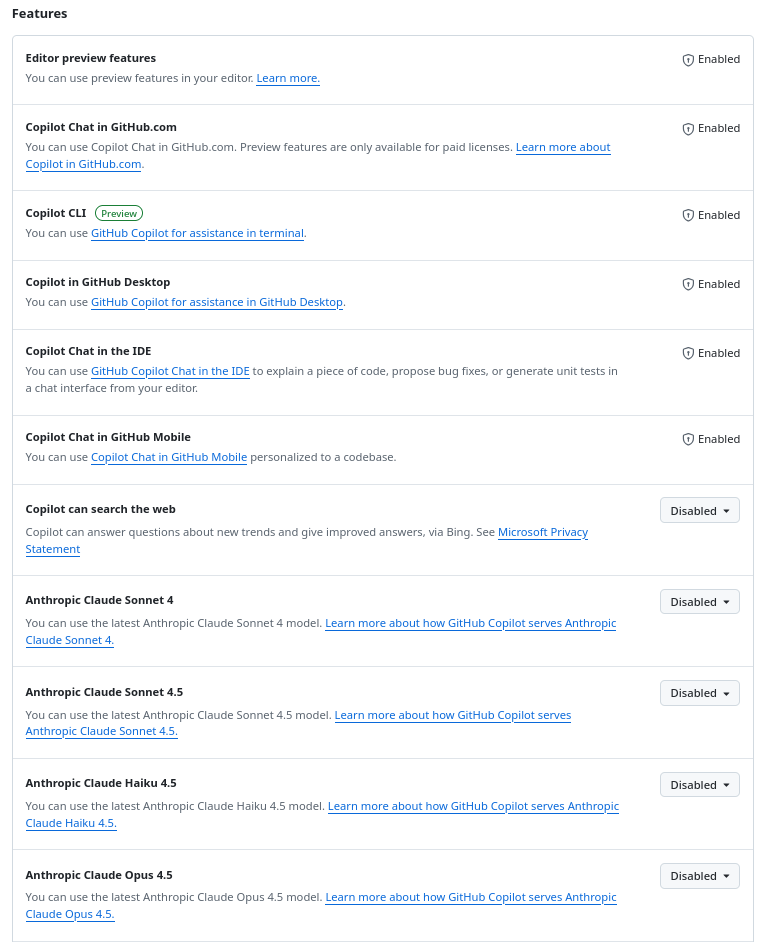
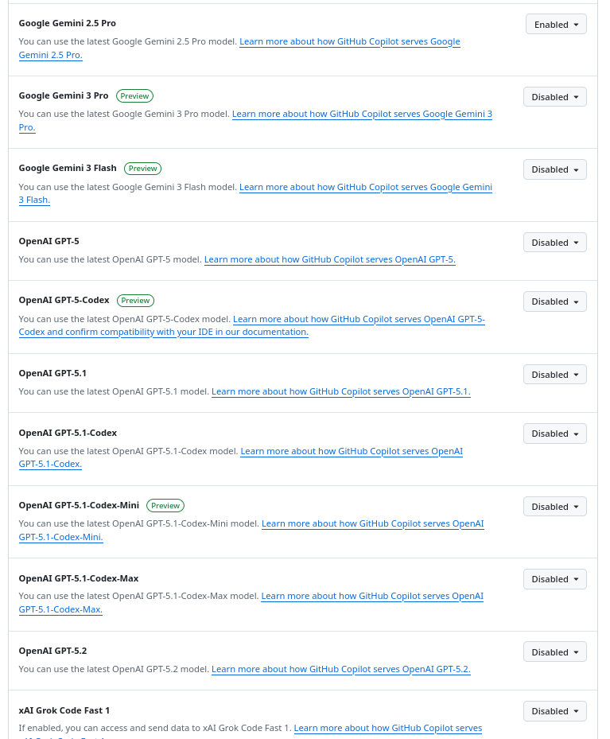

Github Copilot pro Gives you access to GPT-5.2, Claude Opus 4.5, Gemini 3 Pro for free in VS Code through their 30 day free trial. After that you can choose to pay $10/month, pay for your model usage separately through whatever provider or host you own models

First sign up for [Github Copilot Pro free trial](https://github.com/github-copilot/pro)

Then go to [https://github.com/settings/copilot/features](https://github.com/settings/copilot/features)

You must enable access to each model. Yes this is annoying, MS prbl does not want normies getting access to these powerful models, but i've spilled the beans :D Enjoy.

> **Warning / FYI:** Copilot Pro includes a **limited number of premium requests per month** (usage caps apply). The **free access is only for one month**; after that it's **$10/month**, which is a **very good deal** for access to these models inside VS Code.
